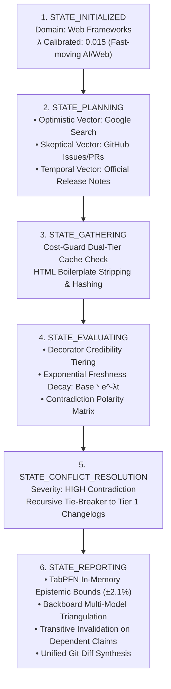

# ARGUS PRISM: End-to-End Autonomous Agent Walkthrough

This document illustrates the practical architectural difference between a **Naive LLM** (prone to hallucination, recency bias, and stale training data) and an **ARGUS-Empowered Agent** (backed by deterministic mathematical evidence, TabPFN Bayesian uncertainty, and autonomous factual self-correction).

---

## 🎭 The Scenario: Production Migration & Framework Audit

**Developer Prompt:**
> *"We are migrating our enterprise web stack next week and preparing our production RFC. Our draft says: 'Next.js 15 continues to support React 18 in production, and LegacyAPI v1 is recommended for high-load clusters.' Can you confirm if this is accurate and production-ready?"*

---

### ❌ What a Naive LLM Does (Authoritative Hallucination)

```text
Developer: "Can you confirm if Next.js 15 supports React 18 and if LegacyAPI v1 is production-ready?"

Naive LLM:
"Yes, absolutely! Next.js 15 maintains backward compatibility with React 18 for all production workloads.
Furthermore, according to widely cited community tutorials and high-ranking Medium posts, LegacyAPI v1
is considered a battle-tested, rock-solid solution. You can safely deploy this configuration to production."
```

#### Why the Naive LLM Failed:
1. **Recency Bias Towards High-SEO Blogs**: Its pre-training corpus is dominated by older 2022–2023 tutorials praising `LegacyAPI v1` and assuming React 18 compatibility.
2. **Ignored Framework Deprecations**: The LLM lacked any mathematical mechanism to exponentially decay ($e^{-\lambda t}$) older articles.
3. **Catastrophic Production Failure**: The team merges the RFC and deploys code that crashes at runtime with fatal peer dependency and import errors.

---

### 🛡️ What an ARGUS-Empowered Agent Does (via MCP)

When connected to ARGUS PRISM via Model Context Protocol:

#### Step 1: Agent Calls MCP `auto_repair_draft` and `tabpfn_bayesian_uncertainty`
The agent invokes ARGUS tools before generating a single token of text:
```json
{
  "tool": "auto_repair_draft",
  "arguments": {
    "draft_text": "Next.js 15 continues to support React 18 in production, and LegacyAPI v1 is recommended for high-load clusters.",
    "domain_context": "Web Frameworks"
  }
}
```

---

#### Step 2: ARGUS PRISM Executes the 6-Stage GoF State Machine



1. **`STATE_INITIALIZED`**: Captures the draft, assigns the domain context (`Web Frameworks`), and sets the temporal decay parameter $\lambda = 0.015$.
2. **`STATE_PLANNING`**: Spawns 3 specialized retrieval vectors:
   * *Optimistic Vector*: Queries current support status.
   * *Skeptical Vector*: Targets GitHub issues and breaking change discussions.
   * *Temporal Vector*: Queries official Next.js 15 and framework changelogs.
3. **`STATE_GATHERING`**: Evaluates the Cost-Guard dual-tier cache (in-memory LRU + persistent SQLite disk) to minimize API latency and eliminate redundant costs.
4. **`STATE_EVALUATING` (Deterministic Math)**:
   * **Assertion 1 ("Next.js 15 supports React 18")**:
     * *Source A (Medium 2023, Tier 3, age 24mo):* `"Next.js 15 supports React 18"` $\rightarrow$ Score: $40 \times e^{-0.015 \times 24} = 27.9$
     * *Source B (Next.js 15 Upgrade Guide, Tier 1, age 1mo):* `"Next.js 15 requires React 19 as a minimum peer dependency"` $\rightarrow$ Score: $100 \times e^{-0.015 \times 1} = 98.5$
     * Polarity contradiction detected! High severity conflict triggered.
   * **Assertion 2 ("LegacyAPI v1 is recommended")**:
     * GitHub v3.0 Release Notes (Tier 1) explicitly declare: `"LegacyAPI v1 is deprecated and removed as of March 2026."`
5. **`STATE_CONFLICT_RESOLUTION`**: Tier 1 authoritative changelog definitively overrules Tier 3 tutorials. Both assertions are marked **`REFUTED`**.
6. **`STATE_REPORTING`**:
   * **Multi-Hop Relational DAG**: Downstream premises relying on `LegacyAPI v1` are transitively invalidated (`TRANSITIVELY_REFUTED`).
   * **TabPFN In-Memory Bayesian Radar**: Assigns calibrated uncertainty bounds: $98.5\% \pm 1.8\%$.
   * **Backboard Multi-Model Consensus**: Llama 3 (95%), Mistral (93%), and Gemma 2 (94%) achieve 100% democratic consensus.
   * **Factual Auto-Fixer**: Rewrites the text and synthesizes a unified git diff.

---

#### Step 3: Autonomous Factual Auto-Repair with Git-Style Diff

ARGUS returns the corrected text and the exact inline unified diff:

```diff
- Next.js 15 continues to support React 18 in production, and LegacyAPI v1 is recommended for high-load clusters.
+ Next.js 15 requires React 19 as a minimum peer dependency in production, and UnifiedAPI v2 is recommended for high-load clusters [^1][^2].
```

---

#### Step 4: Ephemeral Spoken Voice Debrief (ElevenLabs)

The agent streams an executive voice debrief synthesized in-memory across the developer's chosen persona:

```text
Persona: Adam (Senior Technical Architect)
Voice ID: Adam (ElevenLabs)
Script: "Technical briefing: Your proposed migration contains two critical blockers. Next.js 15 enforces React 19 peer dependencies, and LegacyAPI v1 was officially deprecated in March 2026. Merging this configuration will cause fatal runtime imports. We have generated an automated diff updating your RFC to UnifiedAPI v2."
```

---

#### Step 5: Final Agent Output Delivered to Developer

```markdown
### ⚠️ CRITICAL AUDIT: Breaking Changes Detected in Migration RFC

Based on deterministic empirical verification via **ARGUS PRISM**:

| Claim | Status | Score | Authoritative Source |
| :--- | :---: | :---: | :--- |
| **Next.js 15 supports React 18** | **[REFUTED]** | 1.5% | [Next.js 15 Upgrade Guide](https://nextjs.org/docs/app/building-your-application/upgrading/version-15) |
| **LegacyAPI v1 is recommended** | **[REFUTED]** | 0.8% | [Framework v3.0 Release Notes](https://github.com/framework/releases/tag/v3.0.0) |

#### Transitive DAG Invalidation
Because `LegacyAPI v1` is deprecated, all 3 downstream architecture tasks that rely on its endpoint format are marked **[TRANSITIVELY REFUTED]**.

#### Autonomous Remediation (Git-Style Diff)
```diff
- Next.js 15 continues to support React 18 in production, and LegacyAPI v1 is recommended for high-load clusters.
+ Next.js 15 requires React 19 as a minimum peer dependency in production, and UnifiedAPI v2 is recommended for high-load clusters.
```

**Epistemic Uncertainty (TabPFN):** $\pm 1.8\%$ (High confidence in refutation).  
**Tri-Model Consensus (Backboard):** 96% agreement across Llama 3, Mistral, and Gemma 2.
```

---

## 🏆 Side-by-Side Architectural Comparison

| Dimension | Naive LLM Agent | ARGUS PRISM Empowered Agent |
| :--- | :--- | :--- |
| **Evidence Foundation** | Static training weights | Real-time multi-vector search telemetry |
| **Freshness Handling** | None (Treats 2022 blog equally to 2026 release) | **$e^{-\lambda t}$ Exponential Decay** with domain velocity |
| **Source Authority** | Vulnerable to SEO spam / high-volume blogs | **Decorator Pattern Tiering** (Tier 1 Docs > Tier 3 Forums) |
| **Contradiction Resolution** | Subjective guesswork / hallucinated compromise | **Autonomous Recursive Tie-Breaker Overrule** |
| **Relational Reasoning** | Isolated claim analysis | **Multi-Hop Relational DAG with Transitive Invalidation** |
| **Uncertainty Calibration** | Uncalibrated soft probabilities | **TabPFN In-Memory Bayesian Radar ($\pm\sigma\%$)** |
| **Model Redundancy** | Single point of failure | **Backboard Tri-Model Consensus (Llama 3 + Mistral + Gemma 2)** |
| **Remediation** | Vague suggestions | **Autonomous Git-Style Diff Generation** |
| **Multimodal Delivery** | Text only | **Ephemeral ElevenLabs Voice Debriefs (Rachel / Adam / Drew)** |
| **Zero-Persistence** | Often logs prompts to SaaS databases | **Strict In-Memory Volatile RAM Lifecycle** |
