# ARGUS PRISM: Comprehensive Architecture, Mathematical Formulations & Engineering Learnings

> **Deterministic Evidence Intelligence & Autonomous Remediation Layer via Model Context Protocol (MCP)**  
> *Autonomous Hallucination Elimination & Deterministic Evidence Intelligence Engine*

---

## 📖 Table of Contents
1. [Executive Summary & Problem Statement](#1-executive-summary--problem-statement)
2. [The Zero-Persistence Guarantee](#2-the-zero-persistence-guarantee)
3. [Master State Machine Architecture (GoF State Pattern)](#3-master-state-machine-architecture-gof-state-pattern)
4. [Deterministic Mathematical & Probabilistic Framework](#4-deterministic-mathematical--probabilistic-framework)
   - [Source Credibility Tiering (Decorator Pattern)](#41-source-credibility-tiering-decorator-pattern)
   - [Temporal Freshness Decay & Adaptive Velocity ($\lambda$)](#42-temporal-freshness-decay--adaptive-velocity-lambda)
   - [Bayesian Posterior Corroboration & Proportional Conflict Discounting](#43-bayesian-posterior-corroboration--proportional-conflict-discounting)
   - [TabPFN In-Memory Bayesian Radar & Epistemic Uncertainty](#44-tabpfn-in-memory-bayesian-radar--epistemic-uncertainty)
5. [Multi-Model Consensus & Open-Weight LLM Triangulation](#5-multi-model-consensus--open-weight-llm-triangulation)
   - [Google Gemma 2 Local Open-Weight (Ollama)](#51-google-gemma-2-local-open-weight-ollama)
   - [Backboard Open-Weight Tri-Model Arena (Llama 3 + Mistral + Gemma 2)](#52-backboard-open-weight-tri-model-arena-llama-3--mistral--gemma-2)
   - [Deterministic Regex Extraction Fallback](#53-deterministic-regex-extraction-fallback)
6. [Ephemeral Voice Synthesis & Multi-Persona Debriefs (ElevenLabs)](#6-ephemeral-voice-synthesis--multi-persona-debriefs-elevenlabs)
7. [Multi-Hop Relational DAG & Transitive Invalidation](#7-multi-hop-relational-dag--transitive-invalidation)
8. [Autonomous Factual Auto-Fixer with Git-Style In-Line Diffs](#8-autonomous-factual-auto-fixer-with-git-style-in-line-diffs)
9. [Enterprise Deliverables & Export Formats](#9-enterprise-deliverables--export-formats)
   - [Client Verification Certificate](#91-client-verification-certificate)
   - [Academic & Publishing Exporter (Footnotes & IEEE/APA)](#92-academic--publishing-exporter-footnotes--ieeeapa)
   - [Dynamic SVG Verification Badge (`/api/badge`)](#93-dynamic-svg-verification-badge-apibadge)
   - [Standalone HTML Evidence Dossier](#94-standalone-html-evidence-dossier)
10. [Cost-Guard Dual-Tier Cache & Cost Economics](#10-cost-guard-dual-tier-cache--cost-economics)
11. [Sentry Agent Tracing & Observability](#11-sentry-agent-tracing--observability)
12. [Model Context Protocol (MCP 2.x) Integration](#12-model-context-protocol-mcp-2x-integration)
13. [Security Hardening & Threat Mitigation](#13-security-hardening--threat-mitigation)
14. [Full-Stack Interfaces & Cloud Deployment](#14-full-stack-interfaces--cloud-deployment)
15. [Automated Benchmark Verification Suite](#15-automated-benchmark-verification-suite)

---

## 1. Executive Summary & Problem Statement

Modern generative AI agents suffer from a fundamental failure mode: **retrieval over-confidence**. Standard RAG (Retrieval-Augmented Generation) frameworks perform single-pass vector similarity lookups against uncurated or stale text corpora. When an assertion is fabricated or outdated, the LLM hallucinates explanations with authoritative tone, misleading technical users, ghostwriters, and decision-makers.

**ARGUS PRISM** re-engineers this paradigm by treating search engines and documentation registries (SerpApi, DuckDuckGo, GitHub releases, PyPI, MDN) as **pluggable telemetry streams**. It verifies technical claims using:
- Strict **deterministic mathematics** (not subjective LLM prompting).
- **Source credibility tiers** (weighting official registries 1.5x over generic blogs).
- **Temporal freshness decay** (discounting stale 2022 blog claims that conflict with 2026 changelogs).
- **Multi-hop relational DAGs** (propagating transitive invalidations across dependent assertions).
- **Autonomous self-correcting tie-breaker search loops** (actively hunting for deprecations when polarities clash).

---

## 2. The Zero-Persistence Guarantee

Enterprise legal, medical, and ghostwriting compliance demands absolute data privacy. Users cannot risk proprietary technical drafts or confidential patent claims being stored in cloud databases or persisted to server disks.

ARGUS PRISM enforces a **100% Zero-Persistence Policy**:
- **Volatile-RAM Execution**: User drafts, extracted propositions, and audit reports exist strictly in process memory during verification and are dropped immediately upon request lifecycle completion.
- **Zero Disk Logging**: No user prompts or article texts are written to disk, SQLite, or file caches.
- **In-Memory TabPFN & Backboard Routing**: TabPFN executes Bayesian uncertainty inference on transient claim vectors in RAM. Backboard multi-model consensus scores propositions ephemerally without persisting conversational state.
- **Zero-Storage Audio Buffering**: ElevenLabs voice synthesis streams raw WAV bytes directly to the client as base64 in the HTTP response; no audio files are retained on the server.

---

## 3. Master State Machine Architecture (GoF State Pattern)

ARGUS PRISM implements the Gang-of-Four (GoF) **State Pattern** to enforce strict deterministic transitions across six master states:

```mermaid
stateDiagram-v2
    [*] --> STATE_INITIALIZED
    STATE_INITIALIZED --> STATE_PLANNING: configure(topic, domain, lambda)
    
    state STATE_PLANNING {
        [*] --> GenerateOptimisticVector
        GenerateOptimisticVector --> GenerateSkepticVector
        GenerateSkepticVector --> GenerateTemporalVector
        GenerateTemporalVector --> [*]
    }
    
    STATE_PLANNING --> STATE_GATHERING: vectors_ready
    
    state STATE_GATHERING {
        [*] --> SearchProviderDispatch
        SearchProviderDispatch --> RawDocumentNormalization
        RawDocumentNormalization --> Deduplication
        Deduplication --> [*]
    }
    
    STATE_GATHERING --> STATE_EVALUATING: documents_normalized
    
    state STATE_EVALUATING {
        [*] --> ClaimExtractionNode
        ClaimExtractionNode --> CredibilityTieringNode
        CredibilityTieringNode --> FreshnessDecayNode
        FreshnessDecayNode --> ContradictionDetectorNode
        ContradictionDetectorNode --> [*]
    }
    
    STATE_EVALUATING --> STATE_CONFLICT_RESOLUTION: high_severity_conflict [depth < 1]
    STATE_EVALUATING --> STATE_REPORTING: no_conflicts OR resolution_complete
    
    state STATE_CONFLICT_RESOLUTION {
        [*] --> GenerateTieBreakerQuery
        GenerateTieBreakerQuery --> ExecuteTargetedSearch
        ExecuteTargetedSearch --> ReEvaluateClaims
        ReEvaluateClaims --> ReconcileOrFlagUnresolved
        ReconcileOrFlagUnresolved --> [*]
    }
    
    STATE_CONFLICT_RESOLUTION --> STATE_REPORTING: recursion_depth == 1
    
    state STATE_REPORTING {
        [*] --> MultiHopGraphEngine
        MultiHopGraphEngine --> SynthesizeCompositeSummary
        SynthesizeCompositeSummary --> CalculateGlobalConfidence
        CalculateGlobalConfidence --> GenerateEvidenceReport
        GenerateEvidenceReport --> [*]
    }
    
    STATE_REPORTING --> STATE_COMPLETED: payload_validated
    STATE_COMPLETED --> [*]
```

### State Node Responsibilities
1. **`STATE_INITIALIZED`**: Binds the target query, detects technology domain, and calibrates initial temporal decay $\lambda$.
2. **`STATE_PLANNING`**: Synthesizes 3 distinct search vectors:
   - *Optimistic Vector*: Confirmatory queries exploring standard usage.
   - *Skeptical Vector*: Adversarial queries targeting known caveats, pitfalls, and bottlenecks.
   - *Temporal Vector*: Freshness queries targeting deprecation notes, release milestones, and 2026 changelogs.
3. **`STATE_GATHERING`**: Dispatches vectors across the active search strategy (`WebSearchStrategy`, `DuckDuckGoSearchStrategy`, or `MockSearchStrategy`), strips boilerplate HTML, normalizes payloads, and computes SHA-256 deduplication hashes.
4. **`STATE_EVALUATING`**: Extracts atomic claims, tags domains, applies exponential freshness decay, and evaluates polarity agreement.
5. **`STATE_CONFLICT_RESOLUTION`**: Triggers when high-severity polarities clash (e.g. "is production ready" vs "deprecated"). Spawns a targeted tie-breaker search against Tier 1 authoritative changelogs to declare a conclusive winner or flag as contested.
6. **`STATE_REPORTING`**: Assembles the relational DAG, calculates composite factual validity ($0.0\% - 100.0\%$), computes TabPFN uncertainty bounds ($\pm\sigma\%$), and synthesizes deliverables.
7. **`STATE_COMPLETED`**: Emits validated payloads to CLI, REST API, Streamlit, or MCP client.

---

## 4. Deterministic Mathematical & Probabilistic Framework

### 4.1. Source Credibility Tiering (Decorator Pattern)
Every retrieved document is inspected for domain authority and decorated with a weight multiplier $W(d)$:

$$\text{Tier Multipliers} = \begin{cases} 
1.5 & \text{Tier 1: Authoritative Registries (GitHub, PyPI, docs.python.org, MDN, IETF, RFCs)} \\ 
1.0 & \text{Tier 2: Peer-Reviewed Hubs (Stack Overflow, Hacker News, engineering blogs)} \\ 
0.5 & \text{Tier 3: Unverified Web (Medium, SEO listicles, generic blogs)} 
\end{cases}$$

### 4.2. Temporal Freshness Decay & Adaptive Velocity ($\lambda$)
Technical documentation loses validity over time. ARGUS PRISM models freshness using exponential decay:

$$\text{DecayMultiplier}(t) = e^{-\lambda t}$$

Where $t$ is the document age in months derived from SerpApi/HTTP publication timestamps, and $\lambda$ is automatically inferred based on technology velocity:
- **Fast-Moving AI & Web Frameworks** ($\lambda = 0.35$): Half-life $\approx 2$ months. Stale assertions from 2022 or 2024 are heavily penalized.
- **Cloud & Orchestration** ($\lambda = 0.22$): Moderate velocity for Docker, Kubernetes, and cloud provider APIs.
- **Core Systems & Network Standards** ($\lambda = 0.05$): Low velocity for POSIX, Linux kernel syscalls, and TCP/IP RFCs.

### 4.3. Bayesian Posterior Corroboration & Proportional Conflict Discounting
When multiple independent sources corroborate a proposition, confidence is updated via Bayesian likelihood updates:

$$P(H|E) = \frac{P(E|H) \cdot P(H)}{P(E)}$$

If conflicting assertions are detected between sources, ARGUS applies a **Proportional Conflict Discount**:

$$\text{DiscountedScore} = \text{RawScore} \times \max\left(0.40, \, 1.0 - (0.15 \times n_{\text{conflicts}})\right)$$

This prevents binary zeroing when nuanced edge cases or migration differences exist between minor version releases.

### 4.4. TabPFN In-Memory Bayesian Radar & Epistemic Uncertainty
To quantify confidence limits without fine-tuning, ARGUS PRISM incorporates an in-memory **TabPFN (Prior-Data Fitted Network)** Bayesian oracle:
- Takes normalized claim attributes: $[W(d), \text{age}, \text{corroboration\_count}, \text{conflict\_count}]$.
- Computes calibrated posterior class distribution:
  $$[P(\text{VERIFIED}), \, P(\text{CONTESTED}), \, P(\text{REFUTED})]$$
- Estimates an empirical uncertainty confidence interval:
  $$\text{Uncertainty} = \pm \sigma_{\text{Bayes}} \%$$
- Displayed directly on the circular SVG gauge (e.g. `94.5% (±2.4% Uncertainty)`).

---

## 5. Multi-Model Consensus & Open-Weight LLM Triangulation

To eliminate reliance on proprietary, closed-source foundation models, ARGUS PRISM offers pluggable, open-weight reasoning engines:

### 5.1. Google Gemma 2 Local Open-Weight (Ollama)
- Uses `gemma2:2b` executing 100% locally on your workstation via Ollama (`http://localhost:11434`).
- **Zero Cost & Zero Data Leakage**: Claims are extracted and analyzed offline without cloud API tokens.
- Structured JSON outputs guarantee deterministic schema parsing.

### 5.2. Backboard Open-Weight Tri-Model Arena (Llama 3 + Mistral + Gemma 2)
- Routes propositions through Backboard's single-key open-weight gateway.
- Concurrently queries:
  1. **Meta Llama 3 (8B)**
  2. **Mistral (7B)**
  3. **Google Gemma 2 (9B)**
- Cross-references assertions across all three model outputs and generates an **Agreement Ratio**:
  - `3/3 Models Concur`: Full cross-model consensus.
  - `2/3 Models Concur`: Minor divergence; flagged for developer review.
  - `High Hallucination Risk`: Significant dissent among open-weight architectures.

### 5.3. Deterministic Regex Extraction Fallback
- Zero-dependency regex heuristic parser that extracts claims, entity pairs, and version numbers.
- Ensures 100% offline functionality and instantaneous benchmark execution (0.2s runtime).

---

## 6. Ephemeral Voice Synthesis & Multi-Persona Debriefs (ElevenLabs)

Busy executives and technical directors often prefer audio briefings. ARGUS PRISM integrates ElevenLabs TTS to synthesize 60-second broadcast-quality audio summaries:

### Persona Switcher Matrix
| Persona | Voice ID | Style & Acoustic Tone | Ideal Use Case |
| :--- | :--- | :--- | :--- |
| **Rachel** *(Default)* | `21m00Tcm4TlvDq8ikWAM` | Calm, authoritative, professional | Executive C-level audits, client sign-offs |
| **Adam** | `pNInz6obpgDQGcFmaJgB` | Direct, skeptical, sharp | Adversarial QA, code review due diligence |
| **Drew** | `29vD33N1CtxCmqQRPOHJ` | Dynamic, measured, narrative | Ghostwriting briefings, developer podcasts |

- Ephemeral playback: Audio is streamed in-memory as base64 without server-side disk persistence.

---

## 7. Multi-Hop Relational DAG & Transitive Invalidation

Technical propositions do not exist in isolation; they depend on one another. The `ClaimGraphEngine` constructs a directed acyclic evidence graph with typed relations:
- `CONTRADICTS`: Direct opposing polarities on the same entity.
- `REQUIRES`: Prerequisite dependency linking propositions.
- `ENTAILS`: Downstream consequence implied by an assertion.
- `TRANSITIVELY_CONTRADICTS`: **Transitive Invalidation**.

### Transitive Invalidation Mechanism
$$\text{If } A \xrightarrow{\text{CONTRADICTS}} B \quad \text{and} \quad C \xrightarrow{\text{REQUIRES}} B \implies C \text{ is transitively penalized:}$$

$$\text{Score}(C) = \text{Score}(C) \times 0.70$$

If Claim $A$ authoritatively proves a library version was deleted, and Claim $C$ asserts a feature of that deleted library works in production, Claim $C$ is automatically flagged as transitively refuted.

---

## 8. Autonomous Factual Auto-Fixer with Git-Style In-Line Diffs

When an assertion is flagged as `REFUTED`, `WEAK`, or `CONTESTED`, ARGUS PRISM does not merely flag the error; it automatically repairs the text:
1. Identifies the incorrect phrase and pulls the winning Tier 1 evidence citation.
2. Synthesizes a factual, grounded replacement sentence citing official documentation.
3. Computes structured in-line diff blocks:
   - `unchanged`: Verified text preserved verbatim.
   - `removed`: Red strikethrough indicating the hallucinated or deprecated claim.
   - `inserted`: Emerald highlight displaying the corrected assertion with primary source URLs.
4. **1-Click Apply**: Transfers repaired markdown directly into the editor canvas.

---

## 9. Enterprise Deliverables & Export Formats

### 9.1. Client Verification Certificate
- Standalone HTML document verifying draft factual integrity.
- Contains client name, topic, score gauge, proposition breakdown, and SHA-256 verification hash.
- Print-optimized CSS for executive PDF exporting.

### 9.2. Academic & Publishing Exporter (Footnotes & IEEE/APA)
- Formats articles with numerical footnotes (`[^1]`, `[^2]`) linked to verified sources.
- Appends complete IEEE or APA bibliographies with author, title, publication date, and accessed timestamp.
- 1-click clipboard copying for Notion, Substack, Medium, Ghost, and Obsidian.

### 9.3. Dynamic SVG Verification Badge (`/api/badge`)
- Endpoint: `GET /api/badge?score=94.5&verdict=FACTUALLY_SOUND`
- Emits crisp, vector-rendered Shields.io-compliant SVG badges:
  - `VERIFIED` ($\ge 70.0\%$): Emerald `#059669`
  - `CAUTION` ($40.0\% - 69.9\%$): Amber `#d97706`
  - `UNVERIFIED` ($< 40.0\%$): Rose `#e11d48`
- Protected with `Content-Security-Policy: default-src 'none'` and `X-Content-Type-Options: nosniff`.

### 9.4. Standalone HTML Evidence Dossier
- Complete interactive audit dossier with embedded Vis.js evidence graph, contradiction battle cards, and Cost-Guard metrics.

---

## 10. Cost-Guard Dual-Tier Cache & Cost Economics

API search queries cost money ($0.01/call on SerpApi) and introduce network latency. `SerpApiCache` provides a high-performance **Cost-Guard dual-tier caching hierarchy**:
1. **Tier 1 (Memory LRU)**: Sub-millisecond lookup (`0.5ms`) for hot, repeated queries during rapid prototyping.
2. **Tier 2 (SQLite Persistent)**: Disk-backed SQLite database (`.cache/serpapi_cache.sqlite`, `2.0ms`) persisting across restarts with 24-hr TTL.
3. **Cost-Guard Financial Accounting**:
   - Total requests, cache hits, and live API calls.
   - Cache hit rate percentage (e.g. `58.3%`).
   - Estimated USD saved ($0.01 \times \text{hits}$).
   - Latency reduction metrics.

---

## 11. Sentry Agent Tracing & Observability

ARGUS PRISM embeds Sentry OpenTelemetry distributed tracing across all pipeline phases:
- `argus.planning`: Search vector synthesis and query decomposition.
- `argus.gathering`: Search provider dispatch and Cost-Guard cache lookups.
- `argus.evaluation`: Scoring mathematics, decay application, and contradiction detection.
- `argus.tie_breaker`: Autonomous search loop execution and evidence reconciliation.
- **Contradiction Breadcrumbs**: Detailed breadcrumbs capturing conflicting URLs, timestamps, and polarity differentials.

---

## 12. Model Context Protocol (MCP 2.x) Integration

ARGUS PRISM exposes its complete deterministic intelligence layer to autonomous AI agents (Claude Desktop, Cursor, Superagent) via standard Model Context Protocol (MCP) tooling:

### 15 Standard Compliant MCP Tools
1. `validate_claim`: Audit a single technical assertion against empirical sources.
2. `audit_draft`: Complete multi-proposition audit with validity scores and citations.
3. `auto_fix_draft`: Synthesizes factual repairs with git-style diffs.
4. `generate_certificate`: Compiles print-ready HTML verification certificates.
5. `export_academic`: Generates academic markdown with footnotes and IEEE/APA bibliographies.
6. `compare_technologies`: Runs head-to-head empirical trade-off evaluations.
7. `synthesize_audio_debrief`: Generates spoken audio briefings via ElevenLabs personas.
8. `generate_svg_badge`: Returns SVG verification badges for project documentation.
9. `audit_url`: Crawls live URLs, extracts technical text, and validates claims.
10. `inspect_telemetry`: Emits real-time Cost-Guard cache and Sentry span metrics.
11. `evaluate_backboard_consensus`: Triangulates propositions across Llama 3, Mistral, and Gemma 2.
12. `get_tabpfn_distribution`: Returns in-memory Bayesian posteriors and uncertainty bounds.
13. `build_evidence_dag`: Returns multi-hop relational graph topology and transitive penalties.
14. `run_tie_breaker`: Executes an autonomous self-correction search cycle.
15. `get_health`: Returns system status and provider availability.

---

## 13. Security Hardening & Threat Mitigation

During development and security auditing, six key vulnerabilities were identified and hardened:

1. **Server-Side Request Forgery (SSRF) Hardening** ([`url_crawler.py`](backend/src/argus/engine/url_crawler.py)):
   - Implemented `is_safe_public_url` with pre-request DNS resolution and IP address validation.
   - Strictly blocks loopback (`127.0.0.0/8`, `localhost`, `::1`), cloud metadata (`169.254.169.254`), and private RFC 1918 networks (`10.0.0.0/8`, `172.16.0.0/12`, `192.168.0.0/16`).
   - Disabled HTTP auto-redirects (`allow_redirects=False`) to prevent open redirect SSRF bypasses.

2. **Cross-Site Scripting (XSS) Prevention** ([`dossier.py`](backend/src/argus/engine/dossier.py), [`audit_report.py`](backend/src/argus/engine/audit_report.py)):
   - Enforced strict URL scheme checking (`http://` and `https://` only, rejecting `javascript:`, `data:`, and `vbscript:`).
   - Applied `html.escape(url, quote=True)` to all `href` attributes and user content in HTML templates.

3. **Client Certificate `<iframe>` Sandboxing** ([`page.tsx`](frontend/app/page.tsx)):
   - Added `sandbox=""` to the certificate preview modal iframe to prevent child script execution and isolate parent `localStorage`.

4. **Strict CORS Whitelisting & Cloud Security** ([`server.py`](backend/src/argus/api/server.py)):
   - Replaced wildcard origins with a strict whitelist (`localhost:3000`, `8501`, `8000`) and regex pattern matching `https://.*\.onrender\.com`.

5. **Content-Security-Policy (CSP) on SVG Badges** ([`server.py`](backend/src/argus/api/server.py)):
   - Injected `Content-Security-Policy: default-src 'none'` and `X-Content-Type-Options: nosniff` headers to prevent stored SVG-based XSS attacks.

6. **Regex Injection & Backreference Safety** ([`auto_fixer.py`](backend/src/argus/engine/auto_fixer.py)):
   - Replaced direct string substitution in `re.sub()` with a lambda callback: `pattern.sub(lambda _: replacement, text)`, preventing backslashes, `\1`, or LaTeX expressions from corrupting replacements.

---

## 14. Full-Stack Interfaces & Cloud Deployment

ARGUS PRISM is engineered as a decoupled, multi-tier system:
- **FastAPI Core (`backend/src/argus/api/server.py`)**: High-throughput ASGI server exposing REST and MCP endpoints.
- **Next.js 16 Web Studio (`frontend/app/page.tsx`)**: React 19, Tailwind CSS v4, Turbopack, and dark/light theme switching.
- **Streamlit Evidence Explorer (`backend/src/argus/dashboard/app.py`)**: Interactive visualization DAG with temporal decay sliders.
- **Render Blueprint Deployment (`render.yaml`)**: Complete 1-click cloud orchestration for all services with zero manual configuration.

---

## 15. Automated Benchmark Verification Suite

The deterministic scoring pipeline is validated by an automated 7-point evaluation harness ([`backend/evaluate.py`](backend/evaluate.py)):

| Test | Objective | Target Assertion | Expected Result | Status |
| :--- | :--- | :--- | :--- | :--- |
| **Test 1: Hallucination Trap** | Detect non-existent packages | `QuantumReactJS micro-kernel state manager` | Score = 0.0%, Flagged as ungrounded | **PASSED** |
| **Test 2: Contradiction Catch** | Changelog overrules stale blog | `LegacyAPI v1 production readiness` | 2026 changelog elevated, 2022 blog refuted | **PASSED** |
| **Test 3: Traceability** | Verify citation lineage | `FastAPI async performance` | 100% of claims map to Tier 1-2 citations | **PASSED** |
| **Test 4: Reproducibility** | Ensure deterministic scoring | `Pydantic v2 migration` | Exact score match across duplicate runs | **PASSED** |
| **Test 5: Domain Inference** | Validate adaptive $\lambda$ | Multi-domain velocity test | $\lambda=0.35$ (Web), $\lambda=0.05$ (Systems), Bayes in $[0, 1]$ | **PASSED** |
| **Test 6: Cost-Guard Cache** | Verify credit economics | 12 repetitive requests | 7 hits, 58.3% hit rate, $0.07 USD saved | **PASSED** |
| **Test 7: Relational DAG** | Test transitive invalidation | 3-hop proposition chain | Contradiction density > 0, dependent claim penalized | **PASSED** |

**Total Suite Runtime**: **0.21s** across all 7 benchmark tests.  
**Pytest Unit Test Matrix**: **82/82 passing** across all modules.
